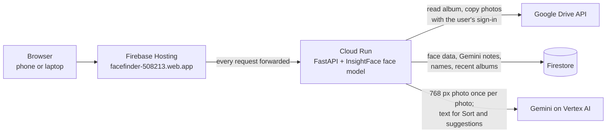

# FaceFinder: submission pack

Google Cloud AI Builder Cup 2026, theme: Media, Content & Digital Experiences.
Live app: <https://facefinder-508213.web.app>

Numbers marked **[TIME FROM TEST]** still need a measured value.

---

## 1. Pitch and description

**One line:** FaceFinder turns one huge shared Google Drive photo album into a
folder per person, so everyone gets their photos in minutes, not hours.

**Description (150 words):**
After a graduation, the photographer shares one Google Drive folder with
thousands of photos. Finding yourself, or sending each friend their photos,
means scrolling for an hour. FaceFinder fixes that. Sign in with Google, paste
the album link, and FaceFinder scans it once. A face-recognition model
(InsightFace) finds every face and groups them into people, so you can name the
people you want or upload a face photo to find someone. Gemini on Vertex AI does
the jobs a face model cannot: it judges each photo's quality to help the
photographer cull, writes a short description so you can sort the album by plain-language descriptions, suggests folders, and explains each pick in a
person's Best 10. When you are happy, FaceFinder creates one folder per person
in your own Drive and copies their photos in. Nothing in the original album is
changed, and photos are never stored by FaceFinder.

---

## 2. How we use Google Cloud

**Face matching uses the InsightFace buffalo_l model running inside our Cloud
Run container, not Gemini.** Gemini never decides who is in a photo.

**Cloud Run.** The whole app runs here as one Docker container: the FastAPI web
server, the front end, and the InsightFace face model, which is built into the
image. It runs in `asia-southeast1` with **one instance** (`--max-instances 1`)
and CPU always on (`--no-cpu-throttling`), deployed with 4 CPUs. The reason:
album scans and folder exports run as background jobs inside the web process,
and their progress is kept in memory, so they need one instance that keeps its
CPU between requests. Scans and exports run as background jobs inside the instance, so no request
has to wait for them.

**Firestore.** Cloud Run's disk is wiped on every restart, so everything that
must last lives in Firestore: the album's scan status; for each photo its size,
a fingerprint for spotting near-identical frames, the **face data** (a
512-number embedding and box per face) and **Gemini's notes** (description,
quality score, flaws, reason); the **names** each account types for people; and
each account's **recent albums**. Accounts are stored under a hash of the email
address. Each photo is one Firestore document.

**Firebase.** Firebase **Hosting** gives the app its public address
(`facefinder-508213.web.app`) and forwards every request to the Cloud Run
service (a `run` rewrite in `firebase.json`). That is all it does. Firebase
does **not** handle sign-in (Google sign-in is done by the app itself with
OAuth), does not store data, and does not run code. The browser never talks to
Firestore directly; only Cloud Run does.

**Gemini on Vertex AI.** Gemini (default model `gemini-3.5-flash`) is reached
through Vertex AI with the Cloud Run service account, so no API key is needed.
During the scan, each photo is shrunk to 768 px and sent **once** to Gemini,
which returns a quality score, flaws (blurry, eyes closed, cut off...), a reason
and a short description. That one note powers:
- **Cull photos:** Keep / Review / Rejected piles for the photographer, each
  photo with a reason.
- **Sort:** describe a folder in plain words (for example "people in
  blue staff shirts") and Gemini puts the matching photos in it, reading the
  stored descriptions rather than the photos again.
- **Folder suggestions:** Gemini reads the album's descriptions and proposes
  ways to sort it.
- **Best 10:** a person's best photos, each with Gemini's one-line reason.

Results are cached per photo (Drive file id plus checksum), so a rescan of the
same photos costs nothing.

**Google Drive API.** FaceFinder reads the album with the **user's own Google
sign-in** and downloads Drive's 1600 px previews instead of the full originals (the
original only when Drive has no preview). Export uses
Drive's server-side `files.copy`: it creates new folders in the user's Drive and
**copies** photos into them. It never moves, changes or deletes anything in the
album.

---

## 3. Architecture

1. The browser opens `facefinder-508213.web.app`; Firebase Hosting forwards
   every request to the Cloud Run service.
2. The user signs in with Google and pastes an album link; Cloud Run reads the
   album's thumbnails through the Drive API with the user's own sign-in.
3. Cloud Run finds every face with InsightFace and asks Gemini once per photo
   for a quality note and description; both are saved in Firestore.
4. Everyone, Find people, Best 10 and Cull work from the stored data; Sort and
   folder suggestions send Gemini the stored text, not the photos.
5. On export, Cloud Run creates one folder per person in the user's Drive and
   copies the photos in with Drive's server-side copy.

---

## 4. Privacy and safety

What FaceFinder keeps (the same as the app's "What FaceFinder keeps" window):
- **Photos are not stored.** They are read from Drive with your sign-in when
  needed. Nothing in your Drive is changed, moved or deleted; exports are copies.
- **Face data:** per face, 512 numbers and where the face sits in the photo. It
  is not a picture, and it is used only to match faces in that album.
- **Gemini's notes:** a short description and quality score per photo, made
  from a copy shrunk to 768 px, sent through Vertex AI. Google Cloud's terms say
  this data is not used to train Google's models.
- **Your names and recent albums,** kept under a coded form of your email. Only
  you see them.
- **Where:** FaceFinder's own Google Cloud project (Firestore, Cloud Run). Face
  crops and thumbnails are kept in memory only. Your sign-in lives in a signed
  cookie and is removed when you sign out.
- **How long:** until deleted, from the album menu ("Delete this album's
  data"). People who can open the same Drive folder share its scan; FaceFinder
  checks with Drive that they can open it first. Deleting removes the scan for
  everyone who uses this folder in FaceFinder; they can scan it again.

**Model licence.** The `insightface` Python library is MIT-licensed, but its
pretrained model packs, buffalo_l included, are released for non-commercial
research use only. FaceFinder uses them as a non-commercial competition
prototype. A commercial release would need a commercial licence from
InsightFace or a commercially licensed face model; only `app/faces.py` would
change.

**Sample photos.** The demo album shows made-up people created with Gemini. No
real people and no public figures.

---

## 5. Video script (under 3 minutes)

On screen at the start and whenever the sample album is visible:
*"Ploy, Ton, Mint, Bank and Fah are made-up people, created with Gemini."*

| Time | On screen | What I say |
|---|---|---|
| 0:00 | A Drive folder with hundreds of graduation photos, scrolling fast. | "After graduation, the photographer shares one folder with thousands of photos. Finding yourself, or sending friends their photos, takes an hour of scrolling." |
| 0:20 | Start page, sign in, open the Sample album card. Caption: face model vs Gemini. | "FaceFinder uses two kinds of AI. A face model, InsightFace, decides who is in each photo. Gemini on Vertex AI judges, describes and sorts photos. Gemini never decides who someone is." |
| 0:40 | Find people: add Ploy with one face photo, results appear. Open Best 10 with Gemini's reasons. Untick one wrong photo. | "I add Ploy with one photo. Her photos appear in seconds. Best 10 shows her best shots, and Gemini says why for each one. If something is wrong, I untick it." |
| 1:10 | Sort tab: Gemini's folder suggestions, then a folder described in plain words ("graduates throwing their caps"). Matching photos fill in. | "Sort lets me describe a folder in plain words. Gemini suggests ideas, and sorts from the descriptions it wrote once during the scan, so it does not read every photo again." |
| 1:45 | Cull photos: Keep, Review, Rejected piles. Open one rejected photo with its reason; tick it back. | "For the photographer, Cull sorts the album into Keep, Review and Rejected. Every photo says why: blurry, eyes closed, a near-copy. I stay in control and can tick any photo back." |
| 2:15 | Press Export to Drive: progress, done card. Then a phone showing Google Drive with Ploy, Ton, Mint, Bank and Fah folders. | "One click creates a folder per person in my own Drive and copies their photos in. The original album is never changed. On my phone, everyone's folder is ready to share." |
| 2:45 | "What FaceFinder keeps" window, then the time-saved number. | "Photos are never stored. Face data and Gemini's notes can be deleted at any time. In our test, finding one person took [TIME FROM TEST] instead of [TIME FROM TEST]. FaceFinder, on Google Cloud." |

---

## 6. Deck outline

1. **Problem**
   - One shared Drive folder after an event holds thousands of photos.
   - Finding yourself means scrolling for an hour; sending friends theirs is worse.
   - Photographers also spend hours culling before they share.
2. **Solution: FaceFinder**
   - Paste a Drive album link; the album is scanned once.
   - Find people, sort by description, cull, pick the best.
   - One folder per person, copied into your own Drive.
3. **Demo**
   - Sample album of made-up people created with Gemini.
   - Find people, Best 10, Sort by description, Cull, export.
   - Live at facefinder-508213.web.app.
4. **How Gemini is used**
   - One look per photo (768 px): quality score, flaws, reason, description.
   - Powers Cull, Sort by description, folder suggestions and Best 10 reasons.
   - Cached per photo, so a rescan costs nothing; face matching stays on InsightFace.
5. **Architecture**
   - Firebase Hosting in front of one Cloud Run service.
   - Firestore for face data, Gemini notes, names and recent albums.
   - Drive API with the user's sign-in; Gemini on Vertex AI without API keys.
6. **Face model accuracy**
   - InsightFace buffalo_l, running in the container.
   - Same person scores 0.75 to 0.98; a different person scores -0.05.
   - Measured on the repo's sample photos (`tests/test_matching`).
7. **Impact**
   - Finding one person: [TIME FROM TEST] instead of [TIME FROM TEST].
   - Scanning a test album of [PHOTOS FROM TEST] photos: [TIME FROM TEST].
   - Server-side copy: no photo is downloaded or uploaded again.
8. **Privacy**
   - Photos are never stored; exports are copies, the album is never changed.
   - Face data is 512 numbers per face, not a picture; deletable from the album menu.
   - Gemini data via Vertex AI is not used to train Google's models.
9. **What's next**
   - Licensed face model for a commercial release.
   - Google verification so the "unverified app" warning goes away.
   - More events beyond graduation: weddings, sports days, conferences.

---

## 7. For judges

- **Open:** <https://facefinder-508213.web.app>
- **Sign in with Google.** Google may show "Google hasn't verified this app".
  Press **Advanced**, then **Go to FaceFinder**. The app asks to read Drive so
  it can open the shared album.
- **Open the Sample album card** on the start page (it shows after sign-in). It
  holds photos of made-up people created with Gemini.

**What to try in 2 minutes:**
1. **Everyone:** see the album grouped into people; type a name on a face.
2. **Find people:** add a person with one face photo and see their photos;
   open Best 10 to read Gemini's reasons.
3. **Sort:** describe a folder in plain words and watch photos fill it.
4. **Cull photos:** see Keep, Review and Rejected, each photo with a reason.
5. **Export to Drive:** copies land in a new `FaceFinder - <album name>` folder in
   your own Drive. You can delete that folder afterwards.
